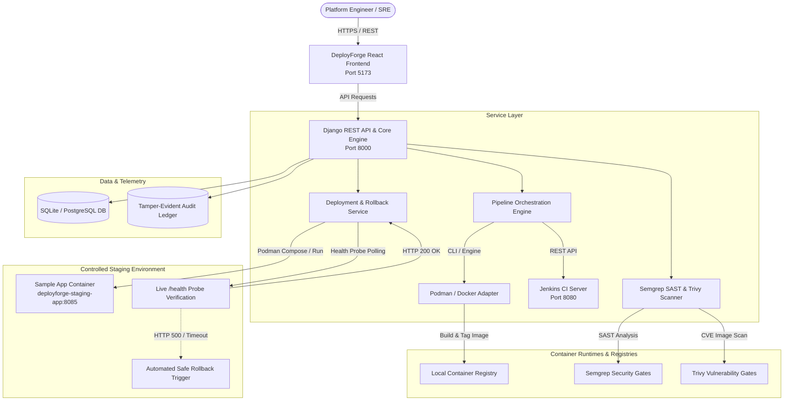

# DeployForge — CI/CD & Deployment Automation Platform

DeployForge is a DevSecOps platform and release management system that orchestrates Jenkins pipelines and manages deployments of containerized applications to controlled development and staging environments.

Jenkins or the integrated pipeline engine executes the actual multi-stage pipeline, and the React frontend displays real pipeline execution logs, stage DAG statuses, security findings, and live container telemetry.

---

## Architecture Overview



---

## Key Features

1. **Project & Repository Registration**:
   - Register Git repositories with URL, credentials, default branch, container runtime (Podman/Docker), and target environment.
   - Built-in sample microservice defaults for zero-friction demonstration.
   - Webhook ingestion with HMAC-SHA256 signature verification.

2. **Full CI/CD Pipeline Orchestration**:
   - Multi-stage pipeline execution DAG:
     1. **Checkout**: Working tree verification
     2. **Lint & Unit Tests**: Pytest execution on service endpoints
     3. **Semgrep SAST Scan**: Static code analysis against OWASP top 10 & credential leakage rules
     4. **Build & Package**: Container packaging with immutable tagging (`<version>-<commit_sha>`)
     5. **Trivy Vulnerability Scan**: Container layer CVE auditing
     6. **Staging Deployment**: Atomic container deployment to staging port 8085
     7. **Smoke & Healthcheck Verification**: Live HTTP probing against `/health` with retries and latency measurement.
   - Paginated console log terminal with copy and search capabilities.

3. **Security Gates & Exception Workflow**:
   - Configurable policy thresholds (e.g., Block on CRITICAL > 0, Block on HIGH > 2).
   - Findings matrix with rule IDs, file locations, and remediation guidelines.
   - Documented exception approval workflow requiring an operator rationale and audit trail logging.

4. **Staging Deployment & Emergency Rollback**:
   - Atomic container swapping with port allocation.
   - Real post-deployment health verification probe.
   - Controlled rollback with mandatory operator confirmation, incident ID tracking, and post-rollback health checks.
   - Preserves baseline data and never overwrites production resources.

5. **Security Boundaries**:
   - Jenkins credentials and webhook secrets are stored backend-side and masked from frontend responses (`••••••••`).
   - Repository code and pipeline outputs are treated as untrusted input.
   - Deployment operations require explicit `confirmed: true` flag.

---

## Directory Structure

```
DeployForge/
├── backend/                  # Django REST Framework backend
│   ├── deployforge_core/     # Project settings & URL routing
│   ├── core/                 # Models, serializers, views, and services
│   │   ├── services/         # Jenkins, Runtime, Security, Deployment services
│   │   └── tests/            # Automated test suite (18 tests)
│   └── manage.py
├── frontend/                 # React 18 + Vite frontend
│   ├── src/
│   │   ├── components/       # Sidebar, Header, Modals (Trigger, Rollback, Register)
│   │   ├── pages/            # Dashboard, Projects, Pipelines, Detail, Security, Rollback
│   │   └── index.css         # Modern dark glassmorphic design system
│   └── index.html
├── sample_app/               # Sample microservice with health probes & telemetry
│   ├── app.py                # Dual-mode Flask / HTTPServer microservice
│   ├── Dockerfile            # Multi-stage minimal container build
│   ├── Jenkinsfile           # Declarative Jenkins CI/CD pipeline
│   └── tests/                # Unit test suite
├── security_policies/        # Security gate configurations
│   ├── semgrep-rules.yml     # Semgrep SAST rules
│   └── trivy-config.yaml     # Trivy CVE thresholds
├── scripts/
│   ├── init_demo.py          # Database baseline seeder
│   └── run_real_pipeline.py  # Local real pipeline integration runner
├── docs/                     # Documentation & API specs
│   └── API.md
├── .env.example              # Environment variables template
└── pytest.ini                # Pytest configuration
```

---

## Quickstart Setup Guide

### Prerequisites
- Python 3.11+
- Node.js 18+ and npm
- Podman or Docker

### 1. Backend Setup

```bash
# In the root repository directory:
source venv/bin/activate

# Apply database migrations:
cd backend
python manage.py migrate

# Seed sample project and baseline deployment:
cd ..
python scripts/init_demo.py

# Start Django backend server (Port 8000):
cd backend
python manage.py runserver 0.0.0.0:8000
```

### 2. Frontend Setup

```bash
# In a new terminal:
cd frontend
npm install
npm run dev
```

Open `http://localhost:5173` in your browser.

---

## End-to-End Demonstration Procedure

### 1. Execute a Real Successful Pipeline Run
Run the integration script to trigger the full 7-stage pipeline with real container build and healthcheck:

```bash
./venv/bin/python scripts/run_real_pipeline.py
```

Observe in the React Dashboard:
- Pipeline run succeeds with green status badges
- Newly tagged container image is packaged and deployed to port 8085
- Live health check returns HTTP 200 OK with latency metrics.

### 2. Demonstrate Automated Failure Catch & Defense
Trigger a pipeline run with an injected health check failure:

```bash
./venv/bin/python scripts/run_real_pipeline.py --simulate-failure health_check
```

Observe:
- Pipeline detects the unhealthy staging container
- Aborts deployment and leaves the previous healthy release active!

### 3. Demonstrate Controlled Emergency Rollback
In the React UI:
1. Navigate to **Rollback Center** or **Deployments**.
2. Click **Emergency Rollback**.
3. Enter an incident rationale (e.g., `Incident #402: Production 500 error spike`).
4. Check the authorization confirmation checkbox and click **Execute Rollback**.
5. Observe live health probe verifying HTTP 200 on the restored healthy image and audit trail logging.

### 4. Running the Automated Test Suite

```bash
./venv/bin/pytest backend/core/tests/ sample_app/tests/ -v
```

All 21 unit and integration tests will execute and pass.

---

## Troubleshooting Guide

1. **Container Engine Socket / Permissions**:
   - If using Podman on macOS, ensure the machine is running:
     ```bash
     podman machine start
     ```
   - Verify container runtime status via DeployForge UI in **Projects -> Test Connection**.

2. **Port 8085 Conflict**:
   - If port 8085 is in use by another service:
     ```bash
     podman rm -f deployforge-staging-app
     ```

3. **Jenkins Outages / Disconnection**:
   - When Jenkins is offline, DeployForge automatically utilizes its in-process pipeline engine so development and staging verification never halts.

---

## Security Policies & Boundaries

- **Secret Isolation**: Secrets (e.g., tokens, webhook secrets) are excluded from log outputs and API serialization.
- **Untrusted Input**: Repository code and scanner JSON outputs are sanitized and validated against schemas.
- **Explicit Confirmation**: Releasing or rolling back requires the `confirmed: true` safety gate.
- **Zero Production Overwrite**: The demo rollback strictly targets the isolated staging container and never touches production infrastructure.
